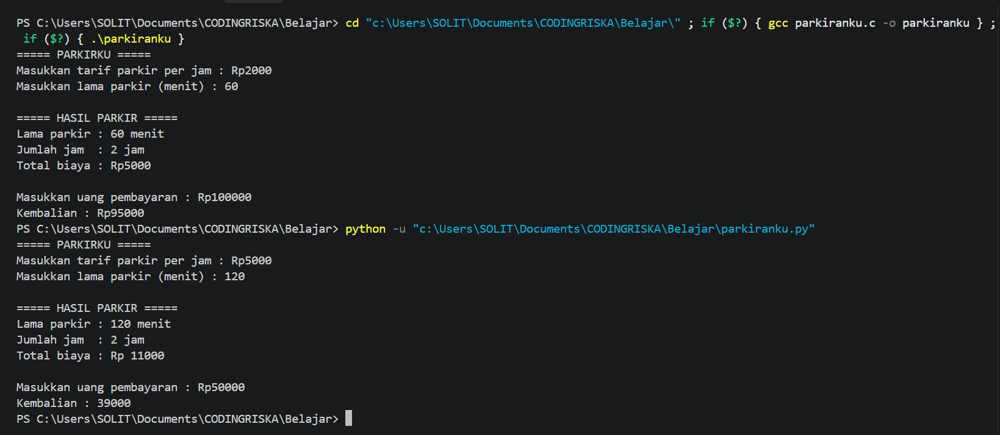

# [parkiranku] 

Project Ujian Tengah Semester (UTS) mata pelajaran Pemrograman Dasar / Koding & Kecerdasan Artifisial kelas X PPLG. Aplikasi ini dibuat dalam dua versi bahasa pemrograman, yaitu **C** dan **Python**.

## Identitas Siswa 
* **Nama Lengkap:** [Riskaenjelina]
* **Kelas:** X PPLG
* **No. Absen:** [31]
* ## Deskripsi Aplikasi [Jelaskan secara singkat aplikasi apa yang kalian buat, fungsi utamanya untuk apa, dan fitur apa saja yang ada di dalamnya.] 
## Daftar File
* `riska_parkiranku.c`  : Kode program utama menggunakan bahasa C.
* `riska_parkiranku.py` : Kode program utama menggunakan bahasa Python.
* `Screenshot 2026-11-19 134327.png`  : Screenshot hasil menjalankan program aplikasi.
* ## Screenshot Output Program   
